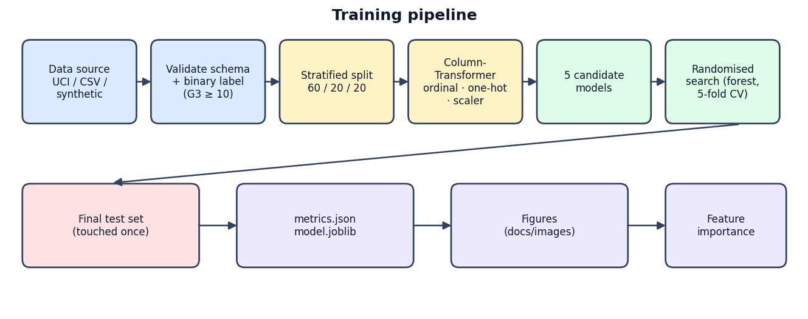
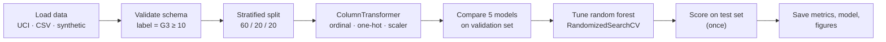
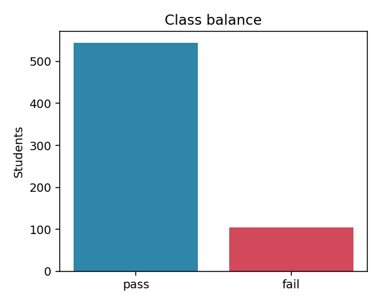
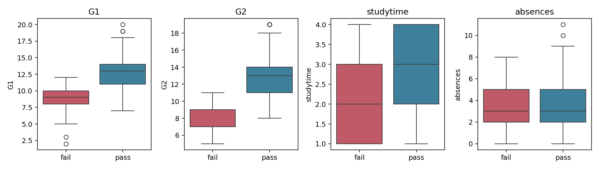
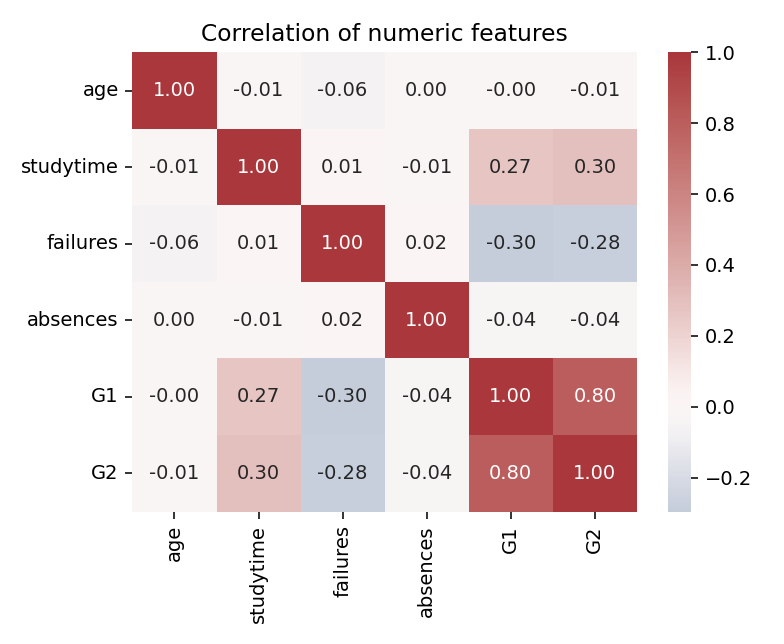
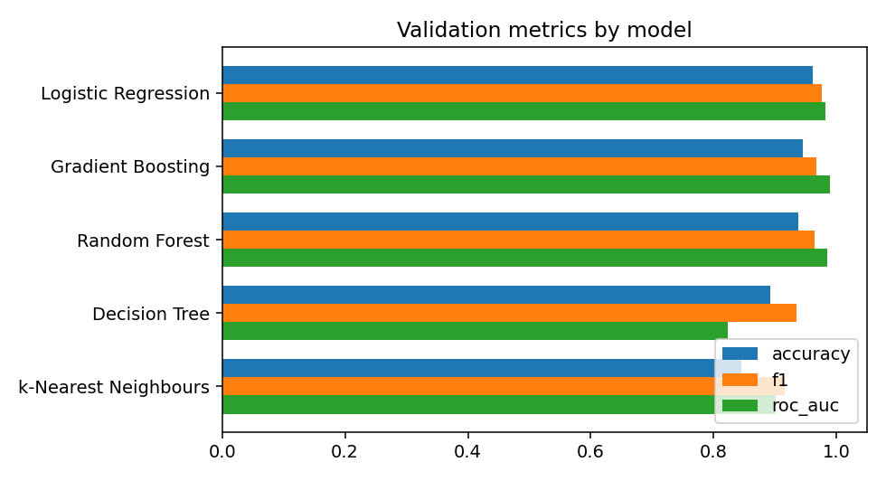
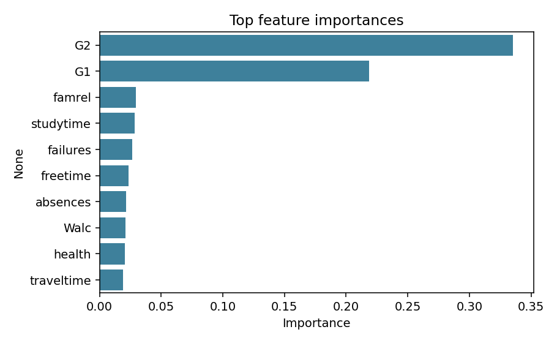
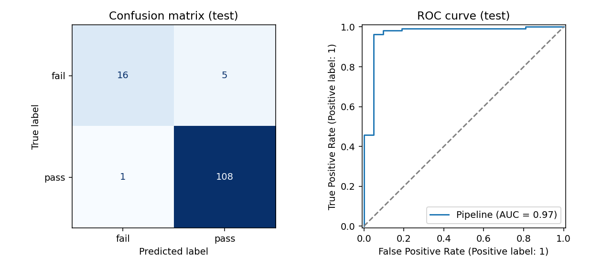
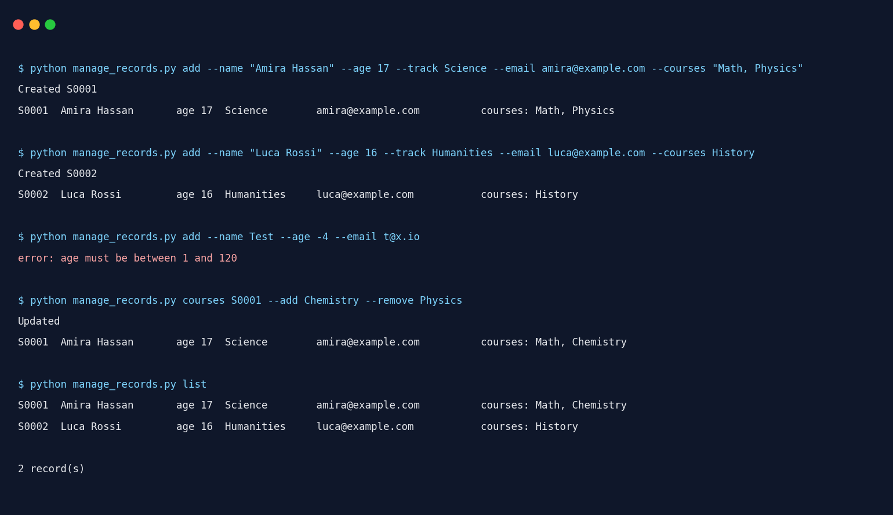
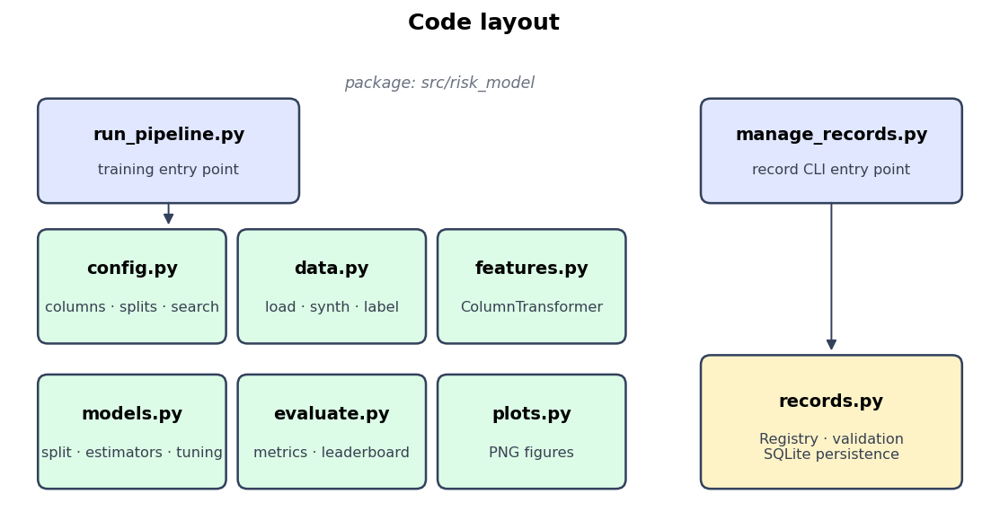

# Academic Risk Predictor - Learner Success Prediction

Reproducible machine-learning project that flags students who are likely to **fail a course** from their grades, study habits and background, plus a lightweight command-line registry for managing student records.

<p align="center">
  
</p>

---

## Highlights

| Area | What you get |
|------|--------------|
| **Leak-free preprocessing** | Encoders and scaler live inside an sklearn `Pipeline`, so they are fitted on training folds only. |
| **Model comparison** | Logistic regression, k-NN, decision tree, random forest and gradient boosting, ranked on a validation set. |
| **Honest evaluation** | Test set is used once, after tuning. ROC AUC is computed from probabilities, not hard labels. |
| **Early-warning mode** | `--no-prior-grades` drops `G1`/`G2` to predict risk before mid-term results exist. |
| **Offline friendly** | `--source synthetic` generates a schema-compatible table, so the whole project runs without internet. |
| **Record manager** | Validated SQLite registry with sub-commands (`add`, `list`, `search`, `update`, `courses`, `delete`). |

## Quick start

```bash
# 1. clone and enter the repository
git clone https://github.com/walidwh21/Academic-Risk-Predictor_Learner-Success-Prediction
cd Academic-Risk-Predictor_Learner-Success-Prediction

# 2. create an environment and install dependencies
python -m venv .venv && source .venv/bin/activate      # Windows: .venv\Scripts\activate
pip install -r requirements.txt

# 3. train on the real UCI data (needs internet)
python run_pipeline.py

# ...or run completely offline on synthetic demo data
python run_pipeline.py --source synthetic

# 4. try the early-warning variant
python run_pipeline.py --no-prior-grades
```

Useful flags:

| Flag | Meaning |
|------|---------|
| `--source {uci,csv,synthetic}` | Where the table comes from (default `uci`). |
| `--csv PATH` | Local file when `--source csv`. |
| `--no-prior-grades` | Exclude `G1` and `G2` from the features. |
| `--n-iter N` | Iterations of the randomised search (default 25). |
| `--no-plots` | Skip figure generation. |

Artefacts are written to `reports/` (`metrics.json`, `model.joblib`) and `docs/images/`.

## How it works



### Data

* **Source:** UCI Machine Learning Repository, *Student Performance* (dataset ID 320), 649 students
* **Target:** the final grade `G3` is converted to a binary label: **pass** when `G3 ≥ 10`, otherwise **fail**.
* **Feature groups** (defined in [`config.py`](src/risk_model/config.py)):

| Group | Columns | Treatment |
|-------|---------|-----------|
| Binary | `sex`, `address`, `Pstatus`, `schoolsup`, `famsup`, `paid`, `activities`, `nursery`, `higher`, `internet`, `romantic` | Ordinal encoding |
| Nominal | `school`, `famsize`, `Mjob`, `Fjob`, `reason`, `guardian` | One-hot encoding (unknown categories ignored) |
| Numeric | `age`, `Medu`, `Fedu`, `traveltime`, `studytime`, `failures`, `famrel`, `freetime`, `goout`, `Dalc`, `Walc`, `health`, `absences`, `G1`, `G2` | Standard scaling |

### Modelling

1. Five candidate estimators are fitted on the training split and compared on the validation split (accuracy, precision, recall, F1, ROC AUC).
2. A random forest is tuned with `RandomizedSearchCV` (5-fold, optimising F1)Preprocessing is part of the searched pipeline, so no information leaks across folds

| Hyper-parameter | Search space |
|-----------------|--------------|
| `n_estimators` | 100, 200, 300, 400, 500 |
| `max_depth` | None, 6, 10, 20 |
| `min_samples_split` | 2, 5, 10 |
| `min_samples_leaf` | 1, 2, 4 |
| `max_features` | sqrt, log2 |

3. The tuned model is evaluated on the held-out test split exactly once.

## Sample output

**Class balance and numeric overview**

<p align="center">
  
  
</p>

**Correlation heat-map**

<p align="center"></p>

**Model comparison on the validation set**

<p align="center"></p>

**Feature importance of the tuned forest**

<p align="center"></p>

**Test-set diagnostics (confusion matrix and ROC curve)**

<p align="center"></p>

## Student record CLI

`manage_records.py` stores students in a local SQLite file (`students.db`). Identifiers (`S0001`, `S0002`, …) keep increasing across sessions, emails must be valid and unique, and ages are range-checked

<p align="center"></p>

```bash
python manage_records.py add --name "Sam Lee" --age 17 --track Science \
       --email sam@example.com --courses "Math, Physics"
python manage_records.py list
python manage_records.py search Science
python manage_records.py show S0001
python manage_records.py update S0001 --age 18
python manage_records.py courses S0001 --add Chemistry --remove Physics
python manage_records.py delete S0001
python manage_records.py --db other.db list      # use a different database file
```

## Project layout

<p align="center"></p>

```text
academic-risk-predictor/
├── run_pipeline.py          # training entry point (argparse)
├── manage_records.py        # record registry entry point (argparse)
├── requirements.txt
├── src/risk_model/
│   ├── config.py            # column groups, split sizes, search space
│   ├── data.py              # UCI / CSV / synthetic loaders, label creation
│   ├── features.py          # ColumnTransformer factory
│   ├── models.py            # split, candidate models, tuning
│   ├── evaluate.py          # metrics, leaderboard, importances
│   ├── plots.py             # figure helpers
│   └── records.py           # Registry class + validation
├── tests/                   # unittest suites
├── docs/images/             # diagrams and generated figures
└── reports/                 # metrics.json / model.joblib (git-ignored model)
```
